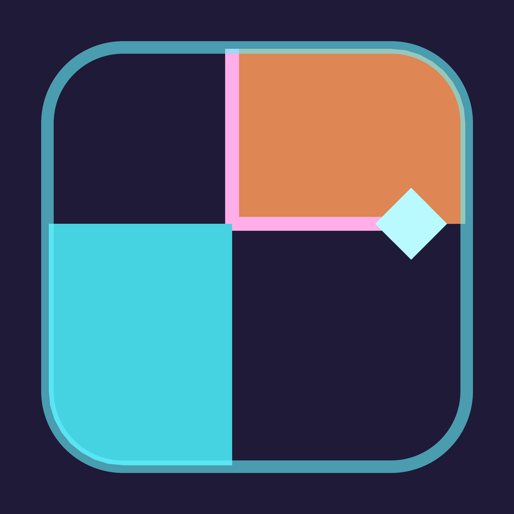
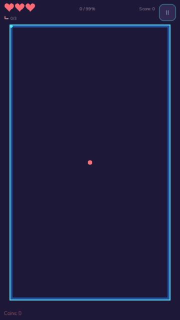
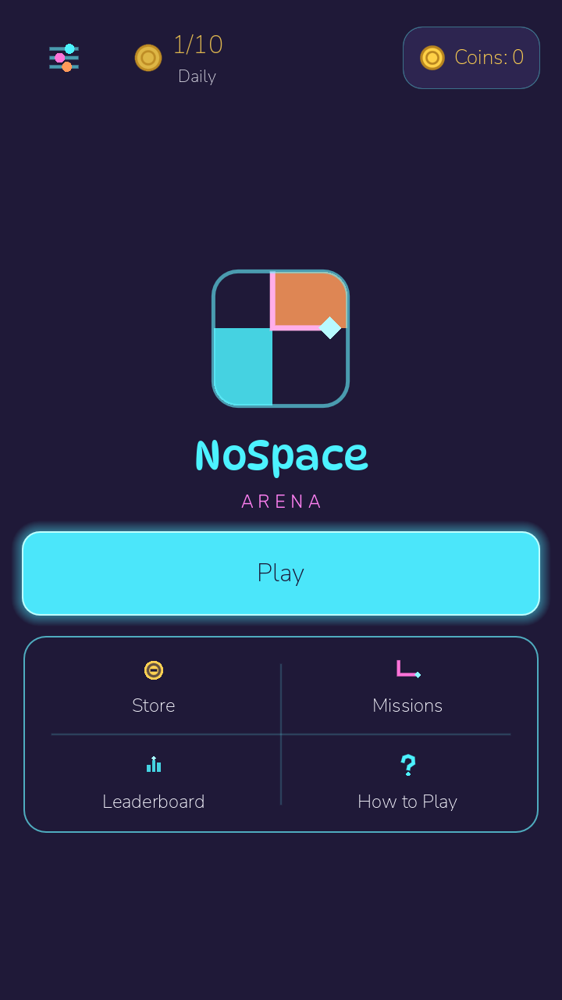
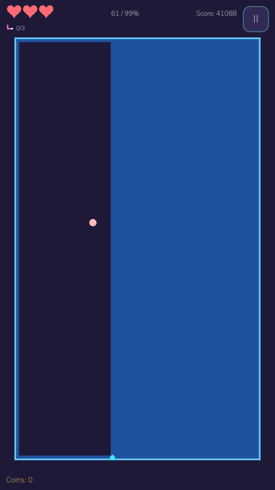
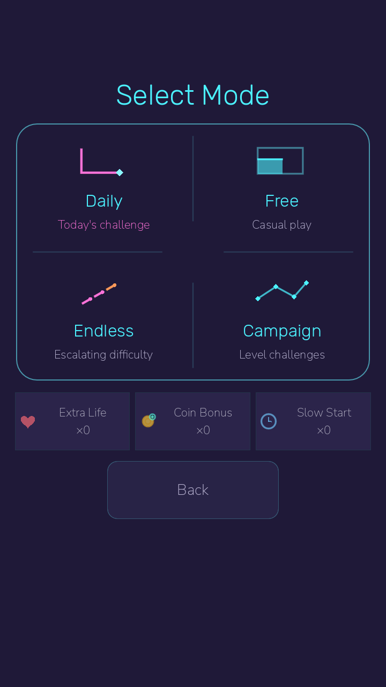

  

<h1 align="center">NoSpace: Arena</h1>

<strong>Draw a line. Take the void.</strong>

A mobile arcade game where the territory you capture becomes part of your defense.

  
  
  

---

## 🎮 Gameplay

  

<strong>Move along the boundary → enter the void → close your line → claim territory.</strong>

Inspired by **Qix** and **Volfied**, every cut is a risk: enemies can reach your exposed line before you reconnect. Captured ground changes the fight through your character's territory effect.

  
  
  

Main Menu · Territory capture · Mode Select Actual Godot gameplay and English UI captures. Select any image to view it at full size.

---

## ✨ Features

| Feature | In the game |
|:--|:--|
| **Living Territory** | Pulse, Drag, and Halt give captured ground distinct defensive effects. |
| **Daily challenge & personal bests** | Date-based arena selection, local best scores, and a replay of your own best-run ghost. |
| **Progression & rewards** | Campaign stars, rotating missions, coins, daily login rewards, and Supply gifts. |
| **Your loadout** | Three arenas, unlockable characters, and Extra Life, Coin Bonus, and Slow Start boosts. |
| **Made for portrait play** | Swipe, tap-to-turn, and D-pad controls; responsive layouts, safe areas, and 18 UI languages. |

## 🕹️ Game Modes

| Mode | The challenge |
|:--|:--|
| **Daily** | A date-based challenge with personal best/ghost tracking. Boosts are disabled. |
| **Free** | Play a single arena with your selected character and arena. |
| **Endless** | Clear successive arenas as enemy pressure and capture targets increase. |
| **Campaign** | Take on 12 authored stages and earn up to three stars per stage. |

---

## 🛠️ Tech Stack

Built with **Godot 4.6.3** and **statically typed GDScript**. Procedural 2D visuals, Godot Resources for authored content, and a shared UI theme keep the presentation consistent. Core game logic is separated from rendering and covered by **GUT** tests.

## 🚧 Development Status

**Playable prototype · Android development builds · Not yet released**

- **Implemented:** the core capture loop, territory effects, four modes, progression, rewards, and multilingual UI.
- **Currently validating:** the UI on physical Android devices. iOS export and device testing are still pending.
- **Planned for v1.1:** roguelite drafting.

English, Turkish, German, French, Spanish, Brazilian Portuguese, Italian, Japanese, Korean,
Simplified Chinese, Traditional Chinese, Russian, Indonesian, Vietnamese, Polish, Hindi, Thai, and Arabic are supported.
New translations await native-speaker review; physical Android acceptance is pending.

Daily scores and ghosts are stored **on the device**. Online rankings and a server-synced Daily clock are not implemented.

---

  Created by <strong>Tuğra Hekimoğlu</strong> 
  Public for portfolio and reference purposes · <strong>All rights reserved</strong> 
  Written permission is required for use, copying, modification, or distribution. 
  <a href="LICENSE">License</a> · <a href="docs/credits.md">Third-party credits</a>

